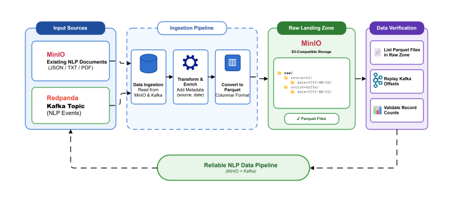

# Lab 111.1 --- Design NLP Data Pipelines (MinIO + Kafka)


## Introduction

DataHive is preparing a searchable knowledge platform that will later
use NLP to process reports, support tickets, and customer feedback. Some
documents have already been uploaded to object storage by other teams,
while new documents arrive continuously from applications. The Data
Engineering team needs one reliable ingestion pipeline that can collect
documents from both places without changing their original text.

In this lab, you will build that pipeline using **MinIO**, an
S3-compatible object storage service, and **Redpanda**, a
Kafka-compatible event streaming platform. A Python application will
read existing JSON documents from a MinIO input prefix and consume new
document events from a Kafka topic. It will preserve the raw text,
convert the records into Parquet, and write them to a MinIO raw landing
zone partitioned by source and date.




## Project structure

Create this workspace in your environment:

``` text
nlp-ingestion-pipeline/
├── data/
│   └── s3_documents/
│       ├── doc_s3_001.json
│       ├── doc_s3_002.json
│       └── doc_s3_003.json
├── src/
│   ├── __init__.py
│   ├── storage.py
│   ├── parquet_utils.py
│   └── pipeline.py
├── scripts/
│   ├── upload_s3_documents.py
│   ├── produce_kafka_documents.py
│   ├── verify_landing_zone.py
│   └── replay_kafka_offsets.py
├── output/
├── .env
├── .env.example
├── .gitignore
├── docker-compose.yml
└── requirements.txt
```

`data/s3_documents/` contains the documents that represent the existing
object-storage source. `scripts/` contains setup and verification
utilities, while `src/` contains reusable pipeline code. The `output/`
directory is used for local verification reports; the actual raw landing
zone will be stored in MinIO.

------------------------------------------------------------------------

## Chapter 1 --- Prepare the Python workspace

Open VS Code, create a folder named `nlp-ingestion-pipeline`, and
open it as your workspace. Open the terminal and create a
virtual environment:

**Linux / macOS / VS Code Server (Bash):**
``` bash
mkdir -p nlp-ingestion-pipeline
cd nlp-ingestion-pipeline

python3 -m venv .venv
source .venv/bin/activate
```


**Windows (PowerShell):**
``` powershell
mkdir nlp-ingestion-pipeline
cd nlp-ingestion-pipeline

python -m venv .venv
.venv\Scripts\Activate.ps1
```

Create `requirements.txt` in the root of `nlp-ingestion-pipeline/`:

``` text
boto3==1.35.99
kafka-python-ng>=2.2.2
pyarrow>=18.1.0
python-dotenv==1.0.1
```

> **Note on `kafka-python-ng`:** Python 3.12+ removed the standard library
> `imp` module, which causes legacy `kafka-python==2.0.2` to crash with
> `ModuleNotFoundError: No module named 'imp'`. Using `kafka-python-ng`
> provides a modern, fully compatible drop-in replacement that uses the exact
> same `from kafka import KafkaConsumer, KafkaProducer` API.

Install the dependencies:

``` bash
python -m pip install --upgrade pip
python -m pip install -r requirements.txt
```


The virtual environment keeps this lab's Python packages separate from
the system Python installation. Boto3 provides the S3-compatible client
used to communicate with MinIO, and `kafka-python-ng` provides the Kafka
consumer and producer. PyArrow writes and reads Parquet files, while
`python-dotenv` loads local configuration from `.env`.

## Chapter 2 --- Start MinIO and Redpanda

We will run both infrastructure services with Docker Compose. Create
`docker-compose.yml`:

``` yaml
services:
  minio:
     image: cgr.dev/chainguard/minio:latest
    container_name: datahive-minio
    command: server /data --console-address ":9001"
    environment:
      MINIO_ROOT_USER: minioadmin
      MINIO_ROOT_PASSWORD: minioadmin
    ports:
      - "9000:9000"
      - "9001:9001"
    volumes:
      - minio_data:/data

  redpanda:
    image: redpandadata/redpanda:v24.2.18
    container_name: datahive-redpanda
    command:
      - redpanda
      - start
      - --overprovisioned
      - --smp
      - "1"
      - --memory
      - "1G"
      - --reserve-memory
      - "0M"
      - --node-id
      - "0"
      - --check=false
      - --kafka-addr
      - "internal://0.0.0.0:9092,external://0.0.0.0:19092"
      - --advertise-kafka-addr
      - "internal://redpanda:9092,external://localhost:19092"
    ports:
      - "19092:19092"
      - "9644:9644"
    volumes:
      - redpanda_data:/var/lib/redpanda/data

volumes:
  minio_data:
  redpanda_data:
```

Start the services:

``` bash
docker compose up -d
docker compose ps
```


Open the MinIO Console in your browser at `http://localhost:9001`. Sign
in with the lab credentials shown below:

-   Username: `minioadmin`
-   Password: `minioadmin`

MinIO exposes its S3-compatible API on port `9000` and its web console
on port `9001`. Redpanda exposes its Kafka API to the host on port
`19092`, allowing Python code running on the host or in VS Code Server
to connect to it. These credentials are for a disposable local lab only;
never reuse them in a production environment.

## Chapter 3 --- Configure the project

Create `.env`:

``` env
MINIO_ENDPOINT=http://localhost:9000
MINIO_ACCESS_KEY=minioadmin
MINIO_SECRET_KEY=minioadmin
MINIO_BUCKET=nlp-data-lake

KAFKA_BOOTSTRAP_SERVERS=localhost:19092
KAFKA_TOPIC=nlp-documents
KAFKA_GROUP_ID=datahive-nlp-ingestion
```

Create `.env.example` with placeholder values:

``` env
MINIO_ENDPOINT=http://localhost:9000
MINIO_ACCESS_KEY=your-access-key
MINIO_SECRET_KEY=your-secret-key
MINIO_BUCKET=nlp-data-lake

KAFKA_BOOTSTRAP_SERVERS=localhost:19092
KAFKA_TOPIC=nlp-documents
KAFKA_GROUP_ID=datahive-nlp-ingestion
```

Create `.gitignore`:

``` text
.venv/
.env
__pycache__/
*.pyc
output/*
```

Create the source and output folders:

``` bash
python -c "import os; [os.makedirs(d, exist_ok=True) for d in ['src', 'scripts', 'data/s3_documents', 'output']]; open('src/__init__.py', 'a').close()"
```

The `.env` file centralizes service endpoints and credentials so that
application code does not need hard-coded configuration values. The
`.env.example` file documents the required variables without exposing
local credentials. The `.gitignore` file prevents the virtual
environment, secrets, and generated reports from being committed to
version control.

## Chapter 4 --- Create the MinIO bucket and upload existing documents

DataHive already has a small collection of documents waiting in object
storage. Create three JSON files inside `data/s3_documents/`.

`data/s3_documents/doc_s3_001.json`:

``` json
{
  "doc_id": "s3-doc-001",
  "text": "The quarterly report shows increased demand for renewable energy solutions.",
  "created_at": "2026-11-18T08:30:00Z"
}
```

`data/s3_documents/doc_s3_002.json`:

``` json
{
  "doc_id": "s3-doc-002",
  "text": "The support team resolved several customer issues related to account access.",
  "created_at": "2026-11-18T08:45:00Z"
}
```

`data/s3_documents/doc_s3_003.json`:

``` json
{
  "doc_id": "s3-doc-003",
  "text": "Product feedback highlights the need for faster document search.",
  "created_at": "2026-11-18T09:00:00Z"
}
```

Create `src/storage.py`:

``` python
import os

import boto3
from botocore.client import Config
from botocore.exceptions import ClientError
from dotenv import load_dotenv

load_dotenv()

MINIO_ENDPOINT = os.getenv("MINIO_ENDPOINT", "http://localhost:9000")
MINIO_ACCESS_KEY = os.getenv("MINIO_ACCESS_KEY", "minioadmin")
MINIO_SECRET_KEY = os.getenv("MINIO_SECRET_KEY", "minioadmin")
MINIO_BUCKET = os.getenv("MINIO_BUCKET", "nlp-data-lake")

s3 = boto3.client(
    "s3",
    endpoint_url=MINIO_ENDPOINT,
    aws_access_key_id=MINIO_ACCESS_KEY,
    aws_secret_access_key=MINIO_SECRET_KEY,
    region_name="us-east-1",
    config=Config(signature_version="s3v4"),
)


def ensure_bucket():
    """Ensure the target bucket exists; create it if missing."""
    try:
        s3.head_bucket(Bucket=MINIO_BUCKET)
    except ClientError as e:
        error_code = e.response.get("Error", {}).get("Code")
        if error_code in ("404", "NoSuchBucket"):
            s3.create_bucket(Bucket=MINIO_BUCKET)
        else:
            existing = [item["Name"] for item in s3.list_buckets().get("Buckets", [])]
            if MINIO_BUCKET not in existing:
                s3.create_bucket(Bucket=MINIO_BUCKET)


def list_objects(prefix):
    """List all objects matching the prefix using pagination."""
    ensure_bucket()
    paginator = s3.get_paginator("list_objects_v2")
    objects = []
    for page in paginator.paginate(Bucket=MINIO_BUCKET, Prefix=prefix):
        objects.extend(page.get("Contents", []))
    return objects


def read_object(key):
    """Read bytes of an object from the bucket."""
    response = s3.get_object(Bucket=MINIO_BUCKET, Key=key)
    return response["Body"].read()


def upload_file(local_path, key):
    """Upload a local file to the bucket."""
    ensure_bucket()
    s3.upload_file(local_path, MINIO_BUCKET, key)


def move_object(source_key, target_key):
    """Move an object within the bucket (copy then delete)."""
    s3.copy_object(
        Bucket=MINIO_BUCKET,
        CopySource={"Bucket": MINIO_BUCKET, "Key": source_key},
        Key=target_key,
    )
    s3.delete_object(Bucket=MINIO_BUCKET, Key=source_key)
```

Create `scripts/upload_s3_documents.py`:

``` python
from pathlib import Path

from src.storage import ensure_bucket, upload_file

PROJECT_ROOT = Path(__file__).resolve().parent.parent
DATA_DIR = PROJECT_ROOT / "data" / "s3_documents"
INPUT_PREFIX = "input/documents/"


def main():
    ensure_bucket()

    files = sorted(DATA_DIR.glob("*.json"))
    if not files:
        raise FileNotFoundError(f"No JSON documents found in {DATA_DIR}")

    for file_path in files:
        object_key = f"{INPUT_PREFIX}{file_path.name}"
        upload_file(str(file_path), object_key)
        print(f"Uploaded: {object_key}")

    print(f"Uploaded {len(files)} documents to MinIO.")


if __name__ == "__main__":
    main()
```

Run the uploader:

``` bash
python -m scripts.upload_s3_documents
```


Open the MinIO Console, select the `nlp-data-lake` bucket, and inspect
`input/documents/`. The script checks whether the target bucket exists,
creates it when necessary, and uploads each local JSON file using an
object key under the `input/documents/` prefix.

## Chapter 5 --- Create the Kafka topic and publish new documents

The application team sends new NLP documents as events. We will
represent this stream with a Kafka topic named `nlp-documents`.

Create the topic using Redpanda's command-line utility inside the
container:

``` bash
docker exec datahive-redpanda rpk topic create nlp-documents \
  --brokers localhost:9092 \
  --partitions 1 \
  --replicas 1
```

Create `scripts/produce_kafka_documents.py`:

``` python
import json
import os
import sys

from dotenv import load_dotenv
from kafka import KafkaProducer

load_dotenv()

BOOTSTRAP_SERVERS = os.getenv(
    "KAFKA_BOOTSTRAP_SERVERS", "localhost:19092"
)
TOPIC = os.getenv("KAFKA_TOPIC", "nlp-documents")

DOCUMENTS = [
    {
        "doc_id": "kafka-doc-001",
        "text": "A new policy update explains the revised data retention rules.",
        "created_at": "2026-11-18T09:15:00Z",
    },
    {
        "doc_id": "kafka-doc-002",
        "text": "The research team published findings about language model evaluation.",
        "created_at": "2026-11-18T09:20:00Z",
    },
    {
        "doc_id": "kafka-doc-003",
        "text": "Customer feedback indicates that search results should be more relevant.",
        "created_at": "2026-11-18T09:25:00Z",
    },
]


def main():
    try:
        producer = KafkaProducer(
            bootstrap_servers=BOOTSTRAP_SERVERS,
            value_serializer=lambda value: json.dumps(value).encode("utf-8"),
            acks="all",
            retries=5,
        )
    except Exception as e:
        print(f"Failed to connect to Kafka broker at {BOOTSTRAP_SERVERS}: {e}")
        sys.exit(1)

    for document in DOCUMENTS:
        try:
            metadata = producer.send(TOPIC, value=document).get(timeout=10)
            print(
                f"Published {document['doc_id']} "
                f"to partition={metadata.partition}, offset={metadata.offset}"
            )
        except Exception as e:
            print(f"Failed to publish {document['doc_id']}: {e}")
            sys.exit(1)

    producer.flush()
    producer.close()
    print(f"Published {len(DOCUMENTS)} documents successfully.")


if __name__ == "__main__":
    main()
```

Run the producer:

``` bash
python -m scripts.produce_kafka_documents
```

The producer uses `acks="all"` and waits for each send result, displaying
the partition and offset assigned to every document.

## Chapter 6 --- Build the Parquet writer

Both ingestion paths must produce the same record structure. We will
preserve the document ID, original text, creation timestamp, and source
name.

Create `src/parquet_utils.py`:

``` python
from datetime import datetime, timezone
from io import BytesIO

import pyarrow as pa
import pyarrow.parquet as pq

from src.storage import MINIO_BUCKET, ensure_bucket, s3

SCHEMA = pa.schema(
    [
        ("doc_id", pa.string()),
        ("text", pa.string()),
        ("created_at", pa.string()),
        ("source", pa.string()),
    ]
)


def write_records(records, source, date_partition=None):
    """Normalize and write a batch of records to a partitioned Parquet file in MinIO."""
    if not records:
        print(f"No records to write for source={source}.")
        return None

    ensure_bucket()

    normalized = []
    for record in records:
        doc_id = str(record.get("doc_id", "")).strip()
        text = str(record.get("text", "")).strip()
        created_at = str(record.get("created_at", "")).strip()

        if not doc_id:
            print(f"Skipping record with missing doc_id: {record}")
            continue

        normalized.append(
            {
                "doc_id": doc_id,
                "text": text,
                "created_at": created_at,
                "source": str(source),
            }
        )

    if not normalized:
        print(f"No valid records remaining after normalization for source={source}.")
        return None

    table = pa.Table.from_pylist(normalized, schema=SCHEMA)

    if not date_partition:
        date_partition = datetime.now(timezone.utc).strftime("%Y-%m-%d")

    timestamp_suffix = datetime.now(timezone.utc).strftime("%H%M%S%f")
    object_key = (
        f"raw/source={source}/date={date_partition}/"
        f"part-{source}-{timestamp_suffix}.parquet"
    )

    buffer = BytesIO()
    pq.write_table(table, buffer, compression="snappy")
    buffer.seek(0)

    s3.put_object(
        Bucket=MINIO_BUCKET,
        Key=object_key,
        Body=buffer.getvalue(),
        ContentType="application/octet-stream",
    )

    print(f"Wrote {len(normalized)} records to {object_key}")
    return object_key
```

The shared schema ensures that documents from MinIO and Kafka have the same
columns, while the `source` field records where each document originated.
The object key follows a Hive-style partition layout (`source=.../date=.../`),
making it easy to locate data by source and ingestion date.

## Chapter 7 --- Implement the two-source ingestion pipeline

Now connect the two sources to the Parquet writer. The MinIO path reads
JSON objects under `input/documents/`, while the Kafka path consumes
events with micro-batching to prevent memory overload and session timeouts.

Create `src/pipeline.py`:

``` python
import json
import os

from dotenv import load_dotenv
from kafka import KafkaConsumer

from src.parquet_utils import write_records
from src.storage import ensure_bucket, list_objects, move_object, read_object

load_dotenv()

KAFKA_BOOTSTRAP_SERVERS = os.getenv(
    "KAFKA_BOOTSTRAP_SERVERS", "localhost:19092"
)
KAFKA_TOPIC = os.getenv("KAFKA_TOPIC", "nlp-documents")
KAFKA_GROUP_ID = os.getenv(
    "KAFKA_GROUP_ID", "datahive-nlp-ingestion"
)
BATCH_SIZE = int(os.getenv("BATCH_SIZE", "500"))


def ingest_minio_documents(archive_processed=False):
    """Ingest existing JSON documents from MinIO input/documents/ prefix."""
    ensure_bucket()
    objects = list_objects("input/documents/")
    records = []
    processed_keys = []

    for item in objects:
        key = item["Key"]
        if not key.endswith(".json"):
            continue

        try:
            raw_bytes = read_object(key)
            document = json.loads(raw_bytes.decode("utf-8"))
            records.append(document)
            processed_keys.append(key)
            print(f"Read MinIO object: {key}")
        except Exception as e:
            print(f"Error reading MinIO object {key}: {e}")

    if records:
        object_key = write_records(records, source="s3")
        print(f"MinIO ingestion complete: {len(records)} documents written to {object_key}.")

        if archive_processed:
            for key in processed_keys:
                archived_key = key.replace("input/documents/", "archive/documents/", 1)
                move_object(key, archived_key)
                print(f"Archived: {key} -> {archived_key}")
    else:
        print("No MinIO documents found under input/documents/ to ingest.")


def ingest_kafka_documents():
    """Consume new document events from Kafka and write them to Parquet in batches."""
    ensure_bucket()
    consumer = KafkaConsumer(
        KAFKA_TOPIC,
        bootstrap_servers=KAFKA_BOOTSTRAP_SERVERS,
        group_id=KAFKA_GROUP_ID,
        auto_offset_reset="earliest",
        enable_auto_commit=False,
        value_deserializer=lambda v: json.loads(v.decode("utf-8")) if v else None,
    )

    records = []
    idle_rounds = 0
    total_consumed = 0

    try:
        while idle_rounds < 5:
            messages = consumer.poll(timeout_ms=1000)

            if not messages:
                idle_rounds += 1
                continue

            idle_rounds = 0
            for partition_messages in messages.values():
                for message in partition_messages:
                    if message.value is None:
                        continue
                    records.append(message.value)
                    total_consumed += 1
                    doc_id = message.value.get("doc_id", "unknown")
                    print(
                        f"Consumed {doc_id} from partition={message.partition}, "
                        f"offset={message.offset}"
                    )

                    # Flush micro-batch when threshold reached to prevent OOM
                    if len(records) >= BATCH_SIZE:
                        write_records(records, source="kafka")
                        consumer.commit()
                        print(f"Committed batch of {len(records)} Kafka records.")
                        records.clear()

        # Flush remaining records after stream becomes idle
        if records:
            write_records(records, source="kafka")
            consumer.commit()
            print(
                f"Kafka ingestion complete: {len(records)} final records written. "
                "Offsets committed after the Parquet upload."
            )
            records.clear()
        elif total_consumed == 0:
            print("No new Kafka documents were available.")

    finally:
        consumer.close()


def main():
    ensure_bucket()
    print("Starting DataHive NLP Ingestion Pipeline...")
    ingest_minio_documents(archive_processed=False)
    ingest_kafka_documents()
    print("Pipeline run completed.")


if __name__ == "__main__":
    main()
```

Run the pipeline:

``` bash
python -m src.pipeline
```


The pipeline executes the existing-object path and then consumes the
Kafka topic. Kafka auto-commit is disabled so that offsets are not
committed before the Parquet output has been uploaded successfully.
Micro-batching prevents memory exhaustion on large event streams.

## Chapter 8 --- List and inspect the raw landing zone

The data should now be available in MinIO under `raw/`. Create
`scripts/verify_landing_zone.py`:

``` python
import sys
from io import BytesIO

import pyarrow.parquet as pq

from src.storage import MINIO_BUCKET, list_objects, s3


def main():
    objects = list_objects("raw/")
    parquet_objects = [
        item for item in objects if item["Key"].endswith(".parquet")
    ]

    print("\nRaw landing zone objects:")
    total_records = 0

    if not parquet_objects:
        print("No Parquet files found in raw landing zone.")
        sys.exit(1)

    for item in parquet_objects:
        key = item["Key"]
        response = s3.get_object(Bucket=MINIO_BUCKET, Key=key)
        table = pq.read_table(BytesIO(response["Body"].read()))

        count = table.num_rows
        total_records += count

        print(f"- {key} | records={count}")
        sample = table.to_pylist()[:5]
        for row in sample:
            print(f"    {row}")

    print(f"\nParquet files: {len(parquet_objects)}")
    print(f"Total landed records: {total_records}")

    if total_records > 0:
        print("PASS: Parquet files and records successfully verified in raw landing zone.")
        sys.exit(0)
    else:
        print("FAIL: Landing zone contains 0 records.")
        sys.exit(1)


if __name__ == "__main__":
    main()
```

Run the verification:

``` bash
python -m scripts.verify_landing_zone
```


You should see separate paths for `source=s3` and `source=kafka`, each with
a date partition and their corresponding records.

## Chapter 9 --- Replay Kafka offsets and verify message delivery

To verify message delivery, we replay the first three Kafka records
directly from partition 0 and compare their document IDs with the
records stored in the Kafka Parquet output.

Create `scripts/replay_kafka_offsets.py`:

``` python
import json
import os
import sys
from collections import Counter
from io import BytesIO

import pyarrow.parquet as pq
from dotenv import load_dotenv
from kafka import KafkaConsumer, TopicPartition

from src.storage import MINIO_BUCKET, list_objects, s3

load_dotenv()

BOOTSTRAP_SERVERS = os.getenv(
    "KAFKA_BOOTSTRAP_SERVERS", "localhost:19092"
)
TOPIC = os.getenv("KAFKA_TOPIC", "nlp-documents")
SAMPLE_SIZE = 3


def read_kafka_landed_ids(date_filter=None):
    """Retrieve all document IDs from the Kafka raw landing zone Parquet files."""
    prefix = f"raw/source=kafka/date={date_filter}/" if date_filter else "raw/source=kafka/"
    landed_ids = []

    for item in list_objects(prefix):
        key = item["Key"]
        if not key.endswith(".parquet"):
            continue

        response = s3.get_object(Bucket=MINIO_BUCKET, Key=key)
        table = pq.read_table(BytesIO(response["Body"].read()))
        landed_ids.extend(row["doc_id"] for row in table.to_pylist() if "doc_id" in row)

    return landed_ids


def replay_sample():
    """Replay SAMPLE_SIZE messages directly from Kafka partition 0."""
    consumer = KafkaConsumer(
        bootstrap_servers=BOOTSTRAP_SERVERS,
        enable_auto_commit=False,
        auto_offset_reset="earliest",
        value_deserializer=lambda v: json.loads(v.decode("utf-8")) if v else None,
    )

    partition = TopicPartition(TOPIC, 0)
    consumer.assign([partition])

    beginning = consumer.beginning_offsets([partition])[partition]
    end = consumer.end_offsets([partition])[partition]
    sample_end = min(beginning + SAMPLE_SIZE, end)

    consumer.seek(partition, beginning)

    replayed_ids = []
    replayed_offsets = []
    empty_polls = 0
    max_empty_polls = 10

    while consumer.position(partition) < sample_end:
        messages = consumer.poll(timeout_ms=1000)
        if not messages:
            empty_polls += 1
            if empty_polls >= max_empty_polls:
                print(f"Warning: Timed out waiting for partition 0 messages up to offset {sample_end}")
                break
            continue

        empty_polls = 0
        for partition_messages in messages.values():
            for message in partition_messages:
                if message.offset < sample_end and message.value is not None:
                    replayed_ids.append(message.value["doc_id"])
                    replayed_offsets.append(message.offset)

    consumer.close()
    return replayed_ids, replayed_offsets


def main():
    print("Replaying Kafka sample offsets...")
    replayed_ids, replayed_offsets = replay_sample()
    landed_ids = read_kafka_landed_ids()

    landed_counts = Counter(landed_ids)

    # Check which replayed sample IDs are missing from the landing zone
    missing = [doc_id for doc_id in replayed_ids if doc_id not in landed_counts]

    # Check if any sample ID was duplicated (landed count > 1)
    sample_duplicates = [
        doc_id for doc_id in replayed_ids if landed_counts.get(doc_id, 0) > 1
    ]

    # Additional non-sample documents present in the landing zone
    replayed_set = set(replayed_ids)
    other_landed = [doc_id for doc_id in landed_ids if doc_id not in replayed_set]

    print(f"Replayed offsets: {replayed_offsets}")
    print(f"Replayed document IDs: {replayed_ids}")
    print(f"Total Kafka landing-zone document IDs found: {len(landed_ids)}")
    print(f"Missing from landing zone: {missing}")
    print(f"Sample duplicate landings: {sample_duplicates}")
    if other_landed:
        print(f"Other landed document IDs (outside sample): {len(other_landed)}")

    if not missing and not sample_duplicates and len(replayed_ids) == SAMPLE_SIZE:
        print("PASS: all replayed sample messages are present exactly once.")
        sys.exit(0)
    else:
        print("CHECK FAILED: investigate the Kafka and Parquet outputs.")
        sys.exit(1)


if __name__ == "__main__":
    main()
```

Run the offset replay:

``` bash
python -m scripts.replay_kafka_offsets
```

The script assigns a separate consumer directly to partition 0 and seeks
to its earliest available offset. It reads the first three records again
without changing consumer group committed offsets. It checks that every
sample ID is present and that none were duplicated, while correctly
accounting for any other messages that landed in the raw zone.

## Chapter 10 --- Review the final output

Run the two verification scripts:

``` bash
python -m scripts.verify_landing_zone
python -m scripts.replay_kafka_offsets
```


Your final raw zone should contain two source partitions:

``` text
nlp-data-lake/
└── raw/
    ├── source=s3/
    │   └── date=YYYY-MM-DD/
    │       └── part-s3-*.parquet
    └── source=kafka/
        └── date=YYYY-MM-DD/
            └── part-kafka-*.parquet
```

## Chapter 11 --- Clean up the environment

When you have finished the lab, stop the containers:

``` bash
docker compose down
```

To remove the persistent MinIO and Redpanda lab volumes:

``` bash
docker compose down -v
```

## Conclusion

DataHive can now collect NLP documents from both an existing MinIO
object prefix and a Kafka topic through one Python ingestion pipeline.
The pipeline preserves the raw document content, writes records as
Parquet, and organizes the output by source and ingestion date. Listing
the raw landing zone and replaying Kafka offsets confirms that the expected
sample documents reached storage reliably.

## Check your understanding

1.  What is the difference between an S3 bucket, an object, and an object key?
2.  Why is MinIO described as S3-compatible rather than Amazon S3?
3.  What information does a Kafka offset represent, and why is it useful for replay?
4.  Why does the pipeline disable Kafka auto-commit and commit only after the Parquet upload?
5.  How does the `source` and `date` partition layout help organize a raw data lake?
6.  Does replaying three sample messages prove that no message can ever be lost in production? Explain the limitation.
